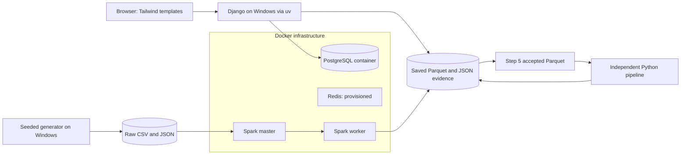
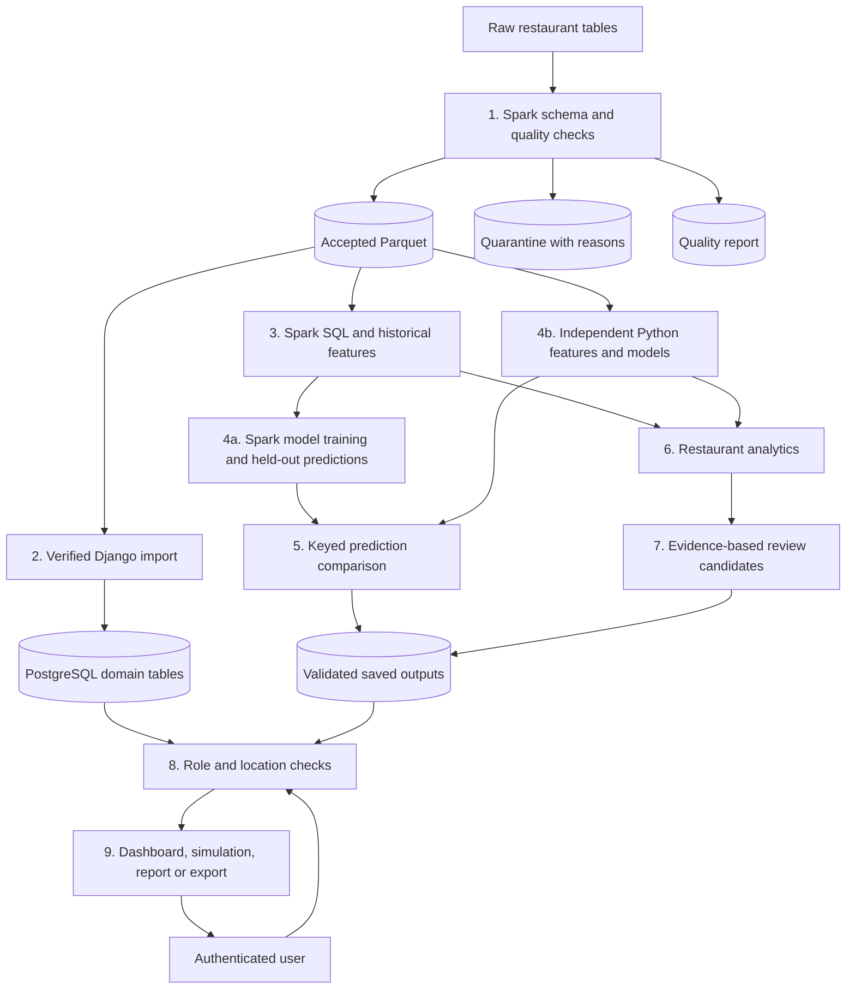
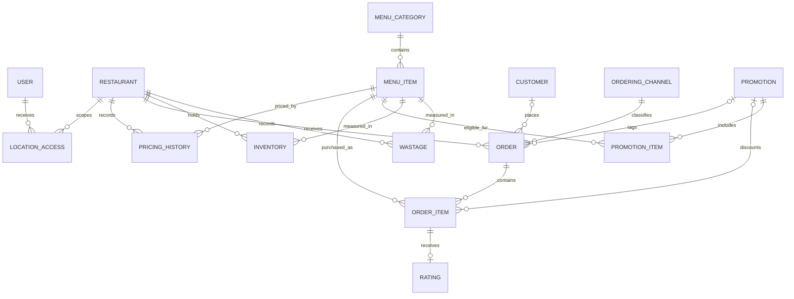
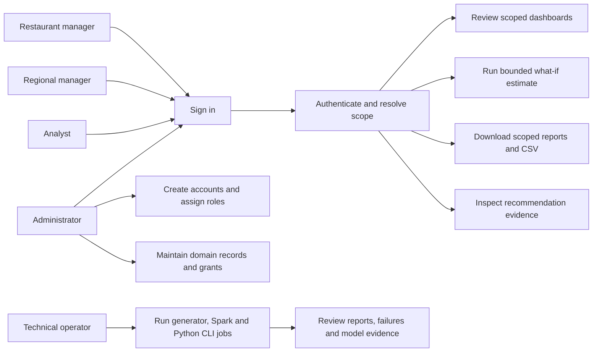
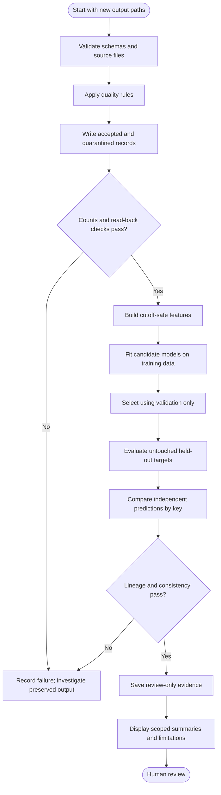
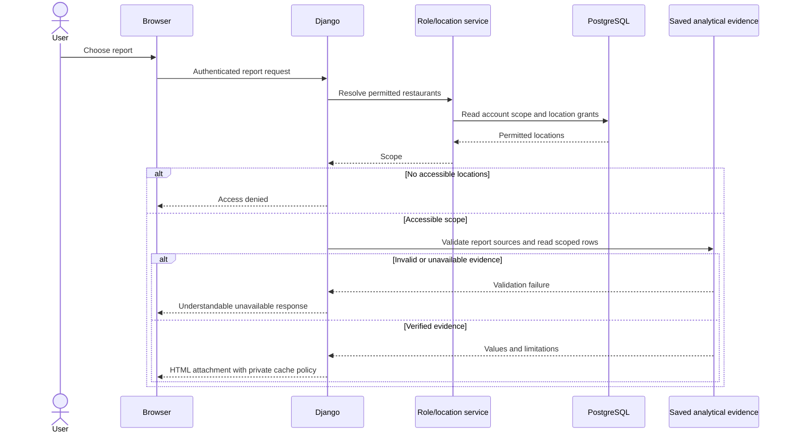

# Design diagrams

These Mermaid source diagrams describe the current implementation at a useful
review level. Render them in a Mermaid-capable viewer before including them in
the final PDF/Word report. They are source diagrams, not rendered UML artifacts.
The activity, sequence and ER views focus on the implemented paths; the use-case
view uses a flowchart representation rather than strict UML actor notation.

## Deployment and system architecture

Redis has no depicted job-queue edge because an application queue integration
has not been verified. The Spark services and host share mounted evidence paths.

## Logical data-flow diagram

## Entity relationships

The diagram omits framework session/admin tables and field-level attributes.
Refer to the [data dictionary](../data_dictionary.md) and migrations for complete
constraints. An accepted order may have no accepted lines; this is tracked as
coverage rather than silently creating a line.

## Use-case view

The technical operator is a deployment responsibility, not an extra business
role. Administrators and analysts have network visibility; restaurant/regional
managers require explicit location grants. Superuser flags are a separate Django
privilege and cannot be granted through the normal account form.

## Processing activity

## Scoped report download sequence

The sequence deliberately has no retraining step in the HTTP request and no
unimplemented audit-event write. Add those only when their implementation is verified.
